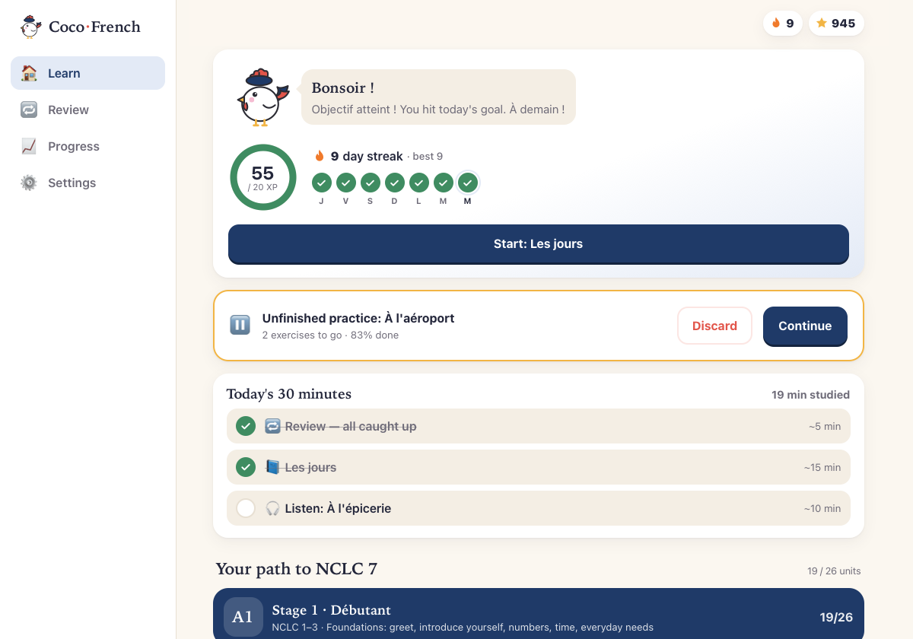
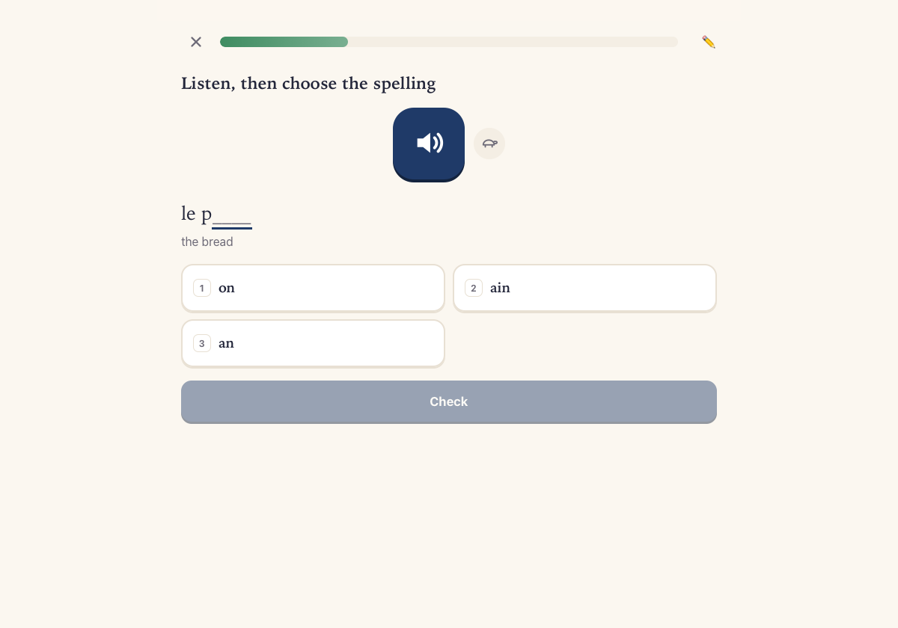
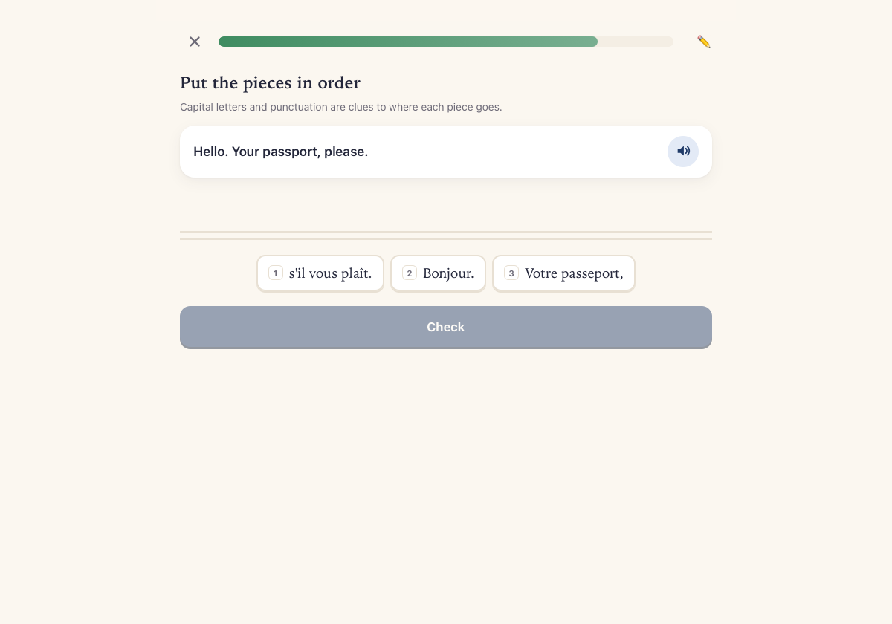
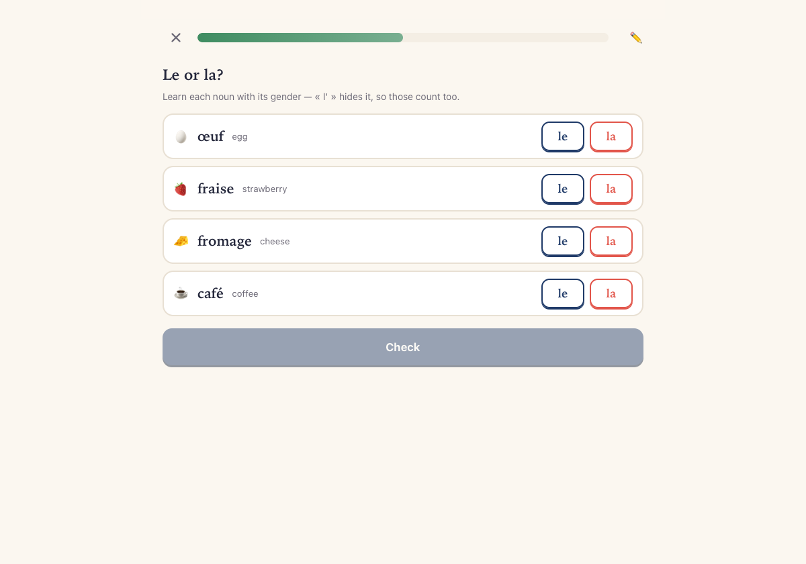
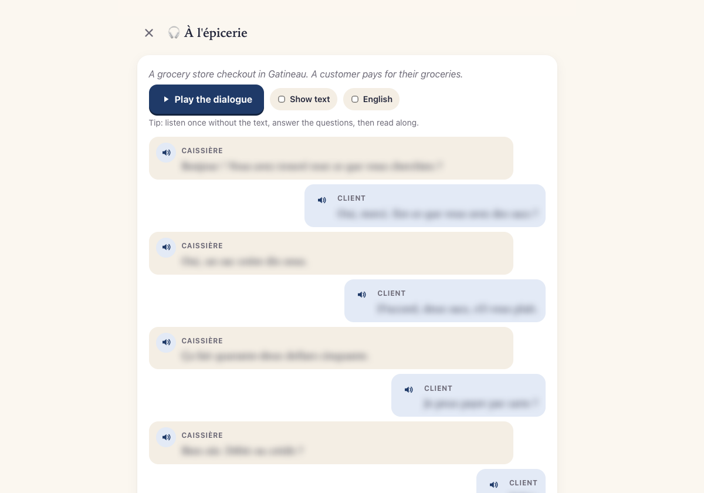
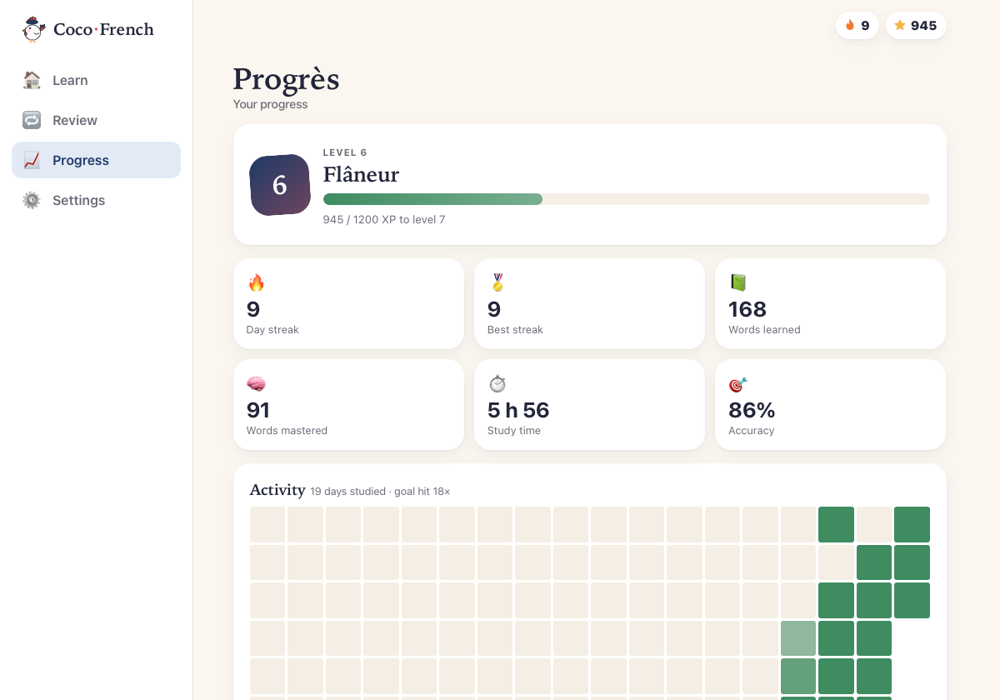

# Coco · French

A private, offline French course from zero toward **NCLC 7** (TEF / TCF Canada), about 30 minutes a day.
No account, no tracking: the app makes no network requests, and lessons, audio and progress stay on your
device. Plan and stages: [ROADMAP.md](ROADMAP.md).

<p>
  
  
  
  
  
  
</p>

## What's inside

- **Stage 1 · A1, 26 units:** vocabulary, 10 grammar lessons, 3 Canadian-life dialogues, and **Les sons**,
  a pronunciation chapter on the vowel sounds and how each is spelled.
- **Practice that varies:** meaning and translation, listening, spelling, matching, dictation, *le or la?*,
  find the mistake, sentence pieces, word order, fill-in-the-blank, and dialogue role-play. Mistakes come
  back at the end.
- **Speaking** 🎤: say words and sentences aloud; OpenAI's Whisper (base) recognizes them on your device and
  never lowers your score.
- **Daily habit:** a 30-minute plan, spaced-repetition review, streaks, levels and achievements.
- **Pick up where you left off:** a practice or review is saved after every answer and resumes where you stopped.

## Run it

| | |
|---|---|
| **Mac** (recommended) | `./scripts/build-mac-app.sh --install` → *Coco French* in Applications (needs Xcode Command Line Tools) |
| **Android** | `./scripts/build-android-app.sh [--install]` → `build/Coco-French.apk` (needs JDK 17 + Android SDK); `--lite` leaves out speaking practice for a much smaller APK |
| **Browser** | double-click `start.command` (Python 3, `127.0.0.1:8642`); opening `index.html` directly works too, but without speaking practice |

For speaking practice, run `./scripts/setup-speech.sh` once **before building** (downloads ~160 MB; needs
Node.js and internet), otherwise the apps are built without it. Each way of opening keeps its own progress;
move it with **Settings → Export backup / Import backup**.

## Develop

```bash
node --test                        # unit tests (js/core.js and the course data)
node scripts/generate-audio.mjs    # audio for new or edited lines (macOS `say`; --force redoes all)
node scripts/generate-art.mjs      # redraw the SVG covers
./scripts/take-screenshots.sh      # README screenshots from demo progress (macOS, after build-mac-app.sh)
```

Course content lives in `js/data.js`: add a unit, list its id in a stage's `units`, then generate its audio.
Ids key saved progress, so never change or reuse them. Your own recordings can replace any clip
(`assets/audio/<id>.m4a`). Logic is in `js/core.js` (no DOM, unit-tested), the UI in `js/app.js`, the Mac app
in `macos/` and Android in `android/`.
